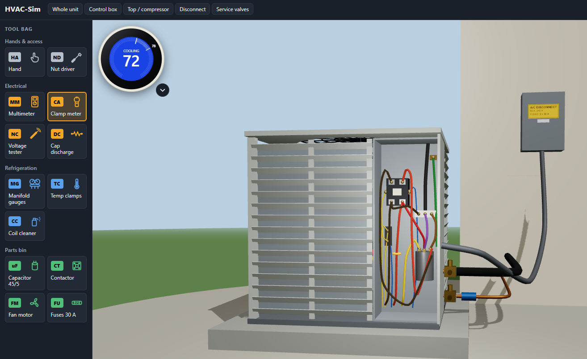

# HVAC-Sim



Interactive 3D trainer for troubleshooting residential HVAC equipment. Two units so far:

- **A/C condenser** - split system, R-410A (`frontend/src/sim`, `backend/app/scenarios.py`)
- **Gas furnace** - 80% single stage, hot-surface ignition, integrated control board
  (`frontend/src/sim/furnace`, `backend/app/furnace_scenarios.py`)

It also covers **EPA Section 608** preparation:

- a hands-on job on the condenser (recover, open the system, nitrogen pressure test, evacuate to
  500 microns with a standing test, weigh the charge back in) - `frontend/src/sim/service.ts`
- practice exams for Core and Types I-III - `backend/app/exam.py`. These are original practice
  questions, not real exam questions. Regulatory figures were checked against epa.gov/section608
  in November 2026; have an instructor review them and re-check when the rules change.

Pick a service call, find the fault with real instruments, make the repair, prove the unit runs,
and get graded.

```
backend/    FastAPI - scenario library, hidden answer key, hints, grading, session history (SQLite)
frontend/   React + TypeScript (strict) + three.js - 3D unit, live simulation, tools and instruments
```

## Run it

Backend (Python 3.12):

```bash
cd backend
python -m venv .venv
.venv/Scripts/python -m pip install -r requirements.txt
.venv/Scripts/python -m uvicorn app.main:app --reload --port 8000
```

Frontend (Node 20+):

```bash
cd frontend
npm install
npm run dev
```

Open http://localhost:5173. The dev server proxies `/api` to port 8000.

## Deploying

See [deploy/README.md](deploy/README.md): the backend goes to a Linux server as its own service,
and the frontend is built into a folder of the website (e.g. `/hvac/`).

## Tests

```bash
cd backend && .venv/Scripts/python -m pytest
cd frontend && npm test && npm run typecheck
```

## How it works

**The simulation runs in the browser** (`frontend/src/sim`) so meter readings are instant:

- `circuit.ts` - a complex-valued nodal-analysis solver.
- `electrical.ts` - the unit's wiring as a network: disconnect and fuses, 2-pole contactor, 24 V
  control circuit with high/low pressure switches, PSC compressor with internal overload, PSC fan
  motor, dual run capacitor. Every voltage, current and resistance the learner measures is solved
  from this network, so things like back-feed through a winding onto a dead leg just happen.
- `engine.ts` - state machines (contactor, compressor start/stall/overload, fan, pressure
  switches) and a first-order refrigerant model (head/suction pressure, superheat, subcooling
  as functions of charge, airflow and coil fouling).
- `instruments.ts` - what the multimeter, clamp meter and voltage tester display.

The **Wiring diagram** button opens a ladder diagram for the unit on the bench
(`frontend/src/ui/WiringDiagram.tsx`). It is drawn de-energised and marks where the meter leads and clamp currently are. On the two
orientation calls a **Trace power** toggle also highlights every energised wire; it is disabled on
fault calls because it would show which switch is open. A new test point must be given a position
there; the typecheck fails until it is.

**The backend keeps the answer key.** A session returns only the unit's *physical values*
(capacitor microfarads, winding ohms, charge level...). The fault label, explanation and hints
stay on the server, and `POST /api/sessions/{id}/submit` grades diagnosis, repair, verified
operation, safety and workmanship. Note the physical values are visible to anyone who inspects
the network traffic; this protects against casual peeking, not a determined cheat.

The **thermostat** sits in the top-left corner of the 3D view (`frontend/src/ui/Thermostat.tsx`):
a standard digital face or a round smart face over the same state, set through one shared dialog.
It calls only when its mode is on and the room is past the setpoint; the room temperature is fixed.

**Chat tutor.** The right-hand pane has a Chat tab backed by `POST /api/sessions/{id}/chat`
(`backend/app/tutor.py`, `backend/app/llm.py`). The backend calls DeepSeek, falling back to OpenAI;
keys come from `backend/.env` (`DEEPSEEK_API_KEY`, `OPENAI_API_KEY`; model names from
`DEEPSEEK_FLASH` / `HVAC_SIM_OPENAI_MODEL`). Each prompt carries a snapshot of what the learner
can see and has measured (`frontend/src/ui/observations.ts`). The tutor is never given the answer
key or the unit's hidden parameters, so it coaches from the readings and cannot leak the fault.
Usage is capped per job and per minute.

Chat entries beginning with `/` are local `power_command` entries and are not sent
to the tutor. `/` lists available commands. `/l` toggles list mode: the exact footer
hover label follows the cursor beside its tool icon. Commands also work while a
tutor reply is pending, and remain available in prompt history.

## Adding a scenario

Equipment JSON contexts, the Goodman heat-pump model, and tutor reply feedback are
described in [Equipment contexts and feedback](docs/equipment-contexts.md).

Add a `Scenario` to `backend/app/scenarios.py`: override the `UnitParams` fields that describe
the fault, and set the `diagnosis_id`, `required_repair`, explanation and hints. No frontend
change is needed unless the fault needs a new physical parameter.

## Simplifications to know about

- Ohms and capacitance across two terminals of the *same* part are measured as if its leads had
  been pulled ("leads pulled for test"); across different parts the reading is in-circuit.
- Time is compressed: pressures settle in tens of seconds, not minutes.
- Low charge is fixed by adding refrigerant; a real job starts with finding the leak.
- The refrigerant model is tuned for believable trends, not engineering accuracy.
